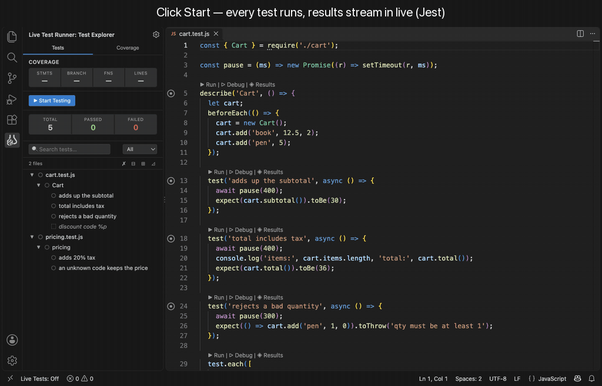

# Live Test Runner

> Save a file. Tests run. Results appear inline. No terminal. No config.

A VS Code extension for **Jest** (including Create React App), **Vitest** and **pytest**. Click Start once; after that every save reruns only the tests the change affects, and the results show in the editor: gutter icons, inline durations, coverage bars, and which tests ran each line.



**Install:** [VS Code Marketplace](https://marketplace.visualstudio.com/items?itemName=EshLabs.live-test-runner) · [Open VSX](https://open-vsx.org/extension/EshLabs/live-test-runner)
**Learn more:** [Website](https://eshandias.github.io/live-test-runner/) · [User guide](https://eshandias.github.io/live-test-runner/guide/) · [Extension README](packages/vscode-extension/README.md)

---

## Features

- **Reruns on save** — only the tests that ran the code you changed (from an execution trace), not whole files.
- **Test tree before you run anything** — every file, suite and test, with `▶ Run` / `▷ Debug` above each one.
- **Failures on the failing line** — the reason after the line, the full message and a side-by-side diff in the hover; **Update snapshot** for a changed snapshot (Jest, Vitest, Angular; asks first).
- **Results panel** — test list, per-test console output, failures with the diff and location, and **Copy for AI** (the failure plus the test's code, clipboard only).
- **Coverage in the editor** — green / amber / red bars per line; hover a line to see the tests that ran it.
- **Angular 21+** — runs through Angular's own `ng test` builder: apps and libraries, coverage, debugging.
- **Monorepos, multi-root workspaces, mixed projects** — one project per package or Python service; Jest and Vitest, or JS and pytest, side by side in one folder.
- **Nothing written into your project** — no installs, no config changes, no cache or coverage files. (Update snapshot rewrites a snapshot only when you confirm it.)

---

## Privacy

No telemetry. No accounts. Live Test Runner makes no network calls: it runs your own Jest, Vitest, Angular or pytest locally and keeps its cache on your machine (clear it any time with **Clear All Cached Data**). It is MIT-licensed and open source, so your security team can review it. Links, such as those in the built-in guide, open in your browser only when you click them.

Your own tests, and VS Code itself, may use the network; that is not the extension. What it keeps, and what it shares only when you click: [PRIVACY.md](PRIVACY.md).

**How to verify:** every pull request runs a test that scans the source and the built extension for network modules, network APIs and telemetry packages, and checks that no view can load anything from another origin ([`noNetwork.test.ts`](packages/vscode-extension/test/noNetwork.test.ts); run it with `pnpm test`).

---

## Feedback

- **Found a bug?** [Open a bug report](https://github.com/EshanDias/live-test-runner/issues/new?template=bug_report.yml)
- **Have an idea?** [Request a feature](https://github.com/EshanDias/live-test-runner/issues/new?template=feature_request.yml)
- **Want to contribute?** See [CONTRIBUTING.md](CONTRIBUTING.md)

---

## Repository layout

| Package | Name | Purpose |
|---------|------|---------|
| `packages/runner` | `@live-test-runner/runner` | Framework-agnostic test execution engine (no VS Code dependency) |
| `packages/core` | `@live-test-runner/core` | Session state |
| `packages/vscode-extension` | `live-test-runner` | The VS Code extension |

Documentation lives in [docs/](docs/README.md), also on the [Wiki](https://github.com/EshanDias/live-test-runner/wiki): what each feature does, what it must do, and how it is built.

```bash
pnpm install
pnpm start          # TypeScript watch mode, then press F5 in VS Code
pnpm test           # unit tests
```

---

## License

[MIT](LICENSE)
