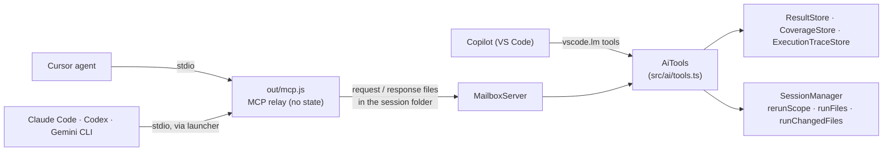

# AI assistants: design

How the feature is built. What it does for users is in [AI assistants](../../features/ai-assistants.md); what it must do is in [the requirements](../../requirements/ai-assistants.md), and the IDs below (A5, A10…) point there.

## Overview

Everything is answered by one class, `AiTools`, over one catalog. The two ways in differ only in transport.

## Key files

| File | Role |
|---|---|
| `src/ai/catalog.ts` | The tools (name, description, input schema, acts or reads) and the ready-made tasks (MCP prompts). package.json's `languageModelTools` is generated from it (`UPDATE_LM_TOOLS=1 npx jest test/aiCatalog.test.ts`) |
| `src/ai/instructions.ts` | The usage text: the MCP `instructions`, the gist added to each VS Code tool description, the snippet for the user's own instructions file |
| `src/ai/tools.ts` → `AiTools` | Every handler; ids, freshness, run answers, the before / after diff |
| `src/ai/host.ts` | `BridgeHost` / `BridgeProject`: what the handlers need from the editor (no VS Code import, so the handlers are unit-tested with real stores) |
| `src/ai/runs.ts` → `AgentRuns` | Assistant runs: one at a time, cancellable, each with the statuses from before it |
| `src/ai/ids.ts` | Workspace-relative ids (`src/a.test.js::Suite::test`) and their way back to store ids, real-path aware |
| `src/ai/AiBridge.ts` | The editor side: the host over `ProjectRegistry`, LM tool and Cursor registration, the mailbox, Fix with AI; an observer for results, Start and Stop |
| `src/ai/protocol.ts`, `src/ai/mailbox.ts` | The file mailbox: `bridge.json`, requests and responses, atomic writes |
| `src/ai/mcp/server.ts`, `main.ts`, `discovery.ts` | The relay (hand-written MCP over stdio) and how it picks a window. Bundled alone into `out/mcp.js` |
| `src/ai/launcher.ts` | The stable launcher in `globalStorage/mcp/`, `current.json` (where the relay is now), one pointer per open window |
| `src/ai/ConnectAiPanel.ts`, `src/ai/nodeRuntime.ts` | The setup page and the absolute Node path for its commands |
| `src/editor/FailureDiagnostics.ts` | Failing tests in the Problems list, and the Fix with AI code action |
| `src/session/SessionManager.ts` → `runFiles`, `runChangedFiles`, `runsStartedAt` | What assistant runs call: ▶ Run on several files, and a save's rerun without the debounce or the session guard |

## How it works

1. **Activation.** `AiBridge` writes `bridge.json` (pid, start time, workspace folders, session folder) into the window's session folder, starts watching `bridge/requests/`, installs the launcher, and registers the tools: `vscode.lm.registerTool` for each catalog tool where it exists, or `vscode.cursor.mcp.registerServer` in Cursor (never both, so no chat sees the tools twice).
2. **A Copilot call** reaches `AiTools.call` in-process.
3. **An MCP call.** The agent starts the relay (Cursor: the editor's own runtime with `ELECTRON_RUN_AS_NODE` and `LTR_SESSION_DIR`; terminal agents: the user's Node and the launcher). The relay answers `initialize`, `tools/list` and `prompts/*` itself; for `tools/call` it picks a window (A11), writes `requests/<id>.json`, and waits for `responses/<id>.json`, checking every second that the window's pid is alive.
4. **Answers** are built when asked (rule 6) and kept small: every list has a limit and a "truncated" note, long text is capped, and each answer carries `running` and `stale` (A9). `stale` = a file changed after the project's latest runs started.
5. **Runs** (A5) queue in `AgentRuns`. `LTR_run_tests` calls `rerunScope` per test / suite and `runFiles` for whole files; `LTR_verify_fix` calls `runChangedFiles`, which reruns what a save would (the trace, else the framework's related run). Each run snapshots every test's status first; its answer counts the tests in its scope plus files that reported during it, and diffs all projects against the snapshot (fixed, newly failing, still failing).
6. **Changes.** Saves and on-disk changes (the session's own events) are noted with a status snapshot taken before the first one. `verify_fix` without files uses them; Start clears them.

## Design decisions

| Decision | Reason | Alternatives considered |
|---|---|---|
| Both ways in, one handler class | Copilot needs no setup through LM tools; everything else speaks MCP; writing tools twice would let them drift | MCP only (Copilot would then need setup); LM tools only (terminal agents left out) |
| A file mailbox, not a socket | No `net` module anywhere keeps the no-network rule absolute and simple to audit; no socket-path limits, stale sockets or Windows pipe naming; ~50 ms per call is nothing next to a test run | A Unix socket / named pipe (instant, but needs `net` and an exception in `noNetwork.test.ts`); a `vscode://` URI handler (one-way, focuses the window) |
| The relay is a separate, stateless bundle | stdio MCP means "a command to start"; an in-extension server would need an HTTP port. Keeping all logic in the window means one source of truth | A full server outside the editor (a second copy of the state) |
| Hand-written MCP | Six methods, newline-delimited JSON-RPC; the SDK would add dependencies to audit for one small file | `@modelcontextprotocol/sdk` |
| A launcher in `globalStorage` | The extension folder changes with every update; the user's one-time command must not | Asking users to re-run setup after updates |
| Window pointers in `globalStorage` too | A sandboxed agent may have its own temp folder and miss `bridge.json` there | Temp-folder scan only |
| Node by absolute path in the setup commands | Agents started from a GUI often have a shorter PATH than the terminal | `node` on PATH |
| Readable ids (`src/a.test.js::Suite::test`) | Agents read and repeat them; they map straight back to store ids, and file paths work as ids | Opaque short ids (`t42`) |
| Runs need no extra confirmation by default | The extension already runs tests on its own; agents ask the user per tool call. `allowRuns` covers stricter needs | A dialog per run (noise) |
| Tasks as tools, not raw rows | Agents choose tools by description and do better with fewer, whole-task tools (`explain_failure` in one call) | One tool per store query |
| Failures as Diagnostics | Every editor's AI already offers fixes for Problems; we get Copilot's and Cursor's for free | Only our own button |

## Testing

- Unit: `aiTools.test.ts` (each tool over real stores: ids, explain, output placeholder, coverage, runs and diffs, allowRuns, cancel), `aiBridge.test.ts` (window choice, the relay in process, the shipped `out/mcp.js` started through the launcher with a different temp folder, setup-command quoting), `aiCatalog.test.ts` (package.json ↔ catalog, no Start / Stop tools), `noNetwork.test.ts` (relay bundle modules, setup page CSP).
- e2e: `ai-bridge` (Jest), `ai-bridge-vitest`, `ai-bridge-pytest`: a scripted MCP client through the launcher reads the failure, fixes the source on disk, verifies and reruns; `vscode.lm.invokeTool` answers the same; Problems list and Fix with AI.
- By hand each release: Copilot agent mode, Cursor's MCP list, Claude Code with the copied command.
- Gaps: `allowRuns: ask`, the bridge turned off, Cursor's registration (A8, A13, A16).
