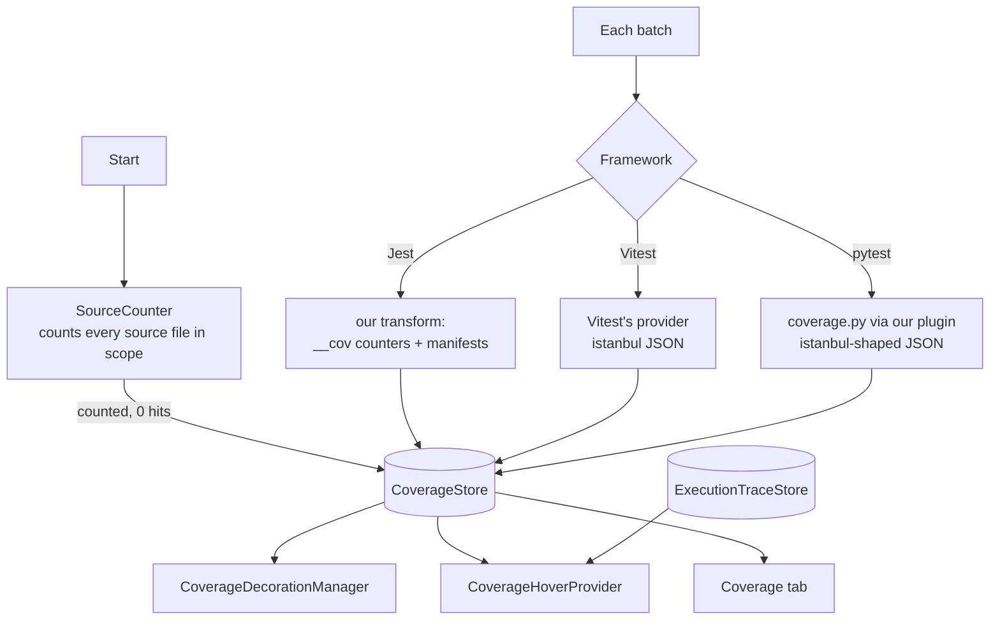

# Coverage: design

How the feature is built. What it does for users is in [Coverage](../../features/coverage.md); what it must do is in [the requirements](../../requirements/coverage.md), and the IDs below (C2, C6…) point there.

## Overview

## Key files

| File | Role |
|---|---|
| `src/coverage/CoverageStore.ts` | Per file: `counted` (denominator only) → `measured` → `measured-stale` on save → `measured` again; totals; off reasons |
| `src/coverage/SourceCounter.ts` | At Start, counts statements / branches / functions / lines of every source file in scope, so untested files count as 0% (C3) |
| `src/coverage/coverageScope.ts` | Which files count: the framework's own include / exclude (C4) |
| `src/coverage/istanbulCoverage.ts` | Reads Vitest's and pytest's istanbul-shaped output into the store |
| `src/coverage/coverageRules.ts` | Merging by line when two frameworks test one file (C10) |
| `src/coverage/statementLines.ts` | The lines a multi-line statement covers (C2) |
| `src/editor/CoverageDecorationManager.ts` | The bars and the stale tint |
| `src/editor/MeasuredLines.ts`, `src/editor/lineMatch.ts` | Map the editor's current lines to the measured ones while editing (C6) |
| `src/editor/CoverageHoverProvider.ts` | Branch arms and covering tests for a line (C5) |
| `src/session/instrumentation/jest/sessionTraceTransform.js` | Jest: instruments source files with counters and writes a manifest per file |

## How it works

1. **Counting at Start.** `SourceCounter` parses the source files in the framework's coverage scope and stores `counted` entries. With no include list, the framework's own report covers only loaded files, so the scan is skipped and totals match the CLI (C3, C4).
2. **Measuring in every run (C1).** Jest: our transform adds counters to each source file and writes a manifest (statement, branch and function locations), named by path and content hash. Each worker appends its counters on exit. Vitest: its own provider writes istanbul JSON into our session folder. pytest: our plugin runs coverage.py with the project's settings, one context per test.
3. **Lines (C2).** A line is uncovered when its statement never ran, partial when a branch on it has an arm with zero hits, covered otherwise. A statement spanning several lines marks each of them.
4. **Covering tests (C5)** come from the execution trace (Jest, Vitest) or coverage.py's per-test contexts (pytest). Status is read from the `ResultStore` at hover time.
5. **Editing (C6).** `MeasuredLines` keeps the text each measurement was taken on and matches the editor's lines to it: common prefix and suffix, then a longest-common-subsequence match of the middle. Indentation must match exactly, while inner spacing is ignored. Moved code loses its bars. When less than half the measured lines remain, the file shows no bars until measured again.
6. **Saving (C7).** The file becomes `measured-stale` (grey tint) until its rerun ends; then the mark is cleared whatever happened.
7. **No coverage package (C9).** The runner reports why coverage is off; the store keeps the reason and the Coverage tab shows it with what to install.

## Design decisions

| Decision | Reason | Alternatives considered |
|---|---|---|
| Measure during normal runs | No second, slower pass; always current | A separate `--coverage` run |
| Use Vitest's and coverage.py's own measurement | Their numbers match the user's own reports and settings | Instrument everything ourselves: double instrumentation, different numbers |
| Count untested files at Start | Totals match the framework's report instead of looking inflated | Only measured files: 100% of the files that ran |
| Manifests on disk, read when drawn (Q1) | Memory stays flat on large projects | Keep every map in memory |
| A thin left border, not a gutter icon | Code never shifts, and the gutter stays free for breakpoints and test icons | Gutter icons: clash with breakpoints |
| No bar on edited lines | A wrong bar is worse than none | Keep old bars on changed lines |

## Testing

- e2e: `coverage-editing`, `vitest-coverage`, `pytest-coverage`, `pytest-no-coverage`, `pytest-related`, `vitest-trace`, `ts-config`, `jest-vue`, `jest-svelte-esm`, `vitest-components`.
- Unit: `statementLines`, `lineMatch`, `coverageScope`, `coverageMerge`, `coverageOff`, `istanbulCoverage`, `sourceMapLookup`.
