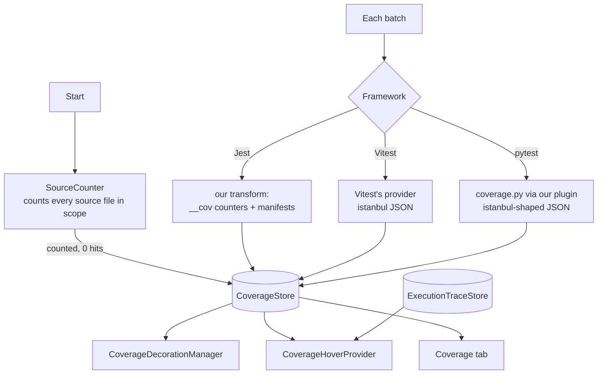

# Coverage: design

How the feature is built. What it does for users is in [Coverage](../../features/coverage.md); what it must do is in [the requirements](../../requirements/coverage.md), and the IDs below (C2, C6…) point there.

## Overview

## Key files

| File | Role |
|---|---|
| `src/coverage/CoverageStore.ts` | Contributions per test file (on disk), summed per source version; entries `counted` → `measured` → `measured-stale` (changed, waiting for its tests) → `measured`; totals with `updating`; off reasons |
| `src/coverage/SourceCounter.ts` | At Start, counts statements / branches / functions / lines of every source file in scope, so untested files count as 0% (C3); `countFile` for a file created or edited later (C15) |
| `src/session/instrumentation/vitest/vitestCoverageProvider.mjs` | Vitest / Angular: wraps the project's own coverage provider and writes each test file's coverage on its own (C18) |
| `src/coverage/coverageScope.ts` | Which files count: the framework's own include / exclude (C4) |
| `src/coverage/istanbulCoverage.ts` | Reads Vitest's and pytest's istanbul-shaped output into the store |
| `src/coverage/coverageRules.ts` | Merging by line when two frameworks test one file (C10) |
| `src/coverage/statementLines.ts` | The lines a multi-line statement covers (C2) |
| `src/editor/CoverageDecorationManager.ts` | The bars and the stale tint |
| `src/editor/MeasuredLines.ts`, `src/editor/lineMatch.ts` | Map the editor's current lines to the measured ones while editing (C6) |
| `src/editor/CoverageHoverProvider.ts` | Branch arms and covering tests for a line (C5) |
| `src/session/instrumentation/jest/sessionTraceTransform.js` | Jest: instruments source files with counters and writes a manifest per file |

## How it works

1. **Counting at Start.** `SourceCounter` parses the source files in the framework's coverage scope and stores `counted` entries. With no include list, the framework's own report covers only loaded files, so the scan is skipped and totals match the CLI (C3, C4).
2. **Measuring in every run (C1).** Jest: our transform adds counters to each source file and writes a manifest (statement, branch and function locations), named by path and content hash; each test file's `afterAll` writes one record (Jest gives every test file a fresh global). Vitest and Angular: the project's own provider, wrapped (`vitestCoverageProvider.mjs`), writes istanbul JSON per test file and merged into our session folder. pytest: our plugin runs coverage.py with the project's settings, one context per test, and writes per test file too.
3. **Contributions (C13, C18).** What one test file's latest run covered is its *contribution*: per source file, the manifest (version) and only the non-zero counters, stored in `coverage-contrib/` in the session folder. A whole-file run of the test file replaces it: the old counters are subtracted from the source version's sum, the new ones added (whole numbers, so exact). Memory holds one summed counter set per source version. A version is *current* when the run that measured it started after the file's last change; the entry shows the current versions (merged by line when Jest and Vitest both test the file), else the newest older one as `measured-stale`.
4. **Refresh (C16).** Single tests rerun by name and related runs (`jest --findRelatedTests`) are plain runs: no coverage. When the last run ends, `SessionManager` waits 750 ms, then reruns in full the test files whose contributions point at an outdated version (`outdatedContributors`), once per change, only in a session. Their results replace the quick ones. While any file waits, the totals carry `updating` and the Coverage tab says so (C17).
5. **Files (C14, C15).** A deleted file or folder: source entries leave, test files' contributions and trace entries go (`removePath`, `forgetTestFiles`). A created or edited source file is counted again: JS / TS by `SourceCounter.countFile`, Python by coverage.py's own analysis (`PytestBatchRunner.countSources` → the plugin's `count_files`, nothing run). Vitest's and coverage.py's merged reports list every file their settings cover; each is kept zeroed, so a file whose tests are gone shows 0%. A plain fallback run marks its test file *unmeasured* (C17).
6. **pytest import-time lines.** Module-level code runs once per process, during collection, outside any test context. The plugin writes it as `imports`; the extension credits each such file to the batch's test files that import it (`PythonImportGraph.dependents`), or to all of them when the graph cannot place it.
7. **Lines (C2).** A line is uncovered when its statement never ran, partial when a branch on it has an arm with zero hits, covered otherwise. A statement spanning several lines marks each of them.
8. **Covering tests (C5)** come from the execution trace (Jest, Vitest) or coverage.py's per-test contexts (pytest). Each test file's whole-file run replaces its entries. Whether a line is covered comes from the counters (the same as the bar). Status is read from the `ResultStore` at hover time.
9. **Editing (C6).** `MeasuredLines` keeps the text each measurement was taken on and matches the editor's lines to it: common prefix and suffix, then a longest-common-subsequence match of the middle. Indentation must match exactly, while inner spacing is ignored. Moved code loses its bars. When less than half the measured lines remain, the file shows no bars until measured again.
10. **Saving (C7).** The file becomes `measured-stale` (grey tint) until its tests have measured the new version: the save's rerun, or the refresh after it.
11. **No coverage package (C9).** The runner reports why coverage is off; the store keeps the reason and the Coverage tab shows it with what to install.

## Design decisions

| Decision | Reason | Alternatives considered |
|---|---|---|
| Measure during normal runs | No second, slower pass; always current | A separate `--coverage` run |
| Use Vitest's and coverage.py's own measurement | Their numbers match the user's own reports and settings | Instrument everything ourselves: double instrumentation, different numbers |
| Count untested files at Start | Totals match the framework's report instead of looking inflated | Only measured files: 100% of the files that ran |
| One contribution per test file, replaced on rerun | Coverage goes down as well as up, exactly; per-file data is what every framework can give | Merge runs with `max` (never goes down); per-test counters (Jest diffing, no Vitest v8 equivalent) |
| Refresh partial runs by a whole-file run, once idle | Exact for every framework with one rule; results get confirmed too; uses the budget only when nothing else runs | Show partial-run coverage (wrong); drop the totals until Start ("restart to see coverage") |
| Vitest: the provider's own `generateCoverage` per test file | Same conversion, source maps and filters as the merged report, on Vitest 3 / 4 / 5 and both providers (vueuse: per-file sums equal the merged report, 0 differences in 288 files; ~10% longer run) | Converting v8 output ourselves: needs Vite's transform results, only inside Vitest |
| Manifests on disk, read when drawn (Q1) | Memory stays flat on large projects | Keep every map in memory |
| A thin left border, not a gutter icon | Code never shifts, and the gutter stays free for breakpoints and test icons | Gutter icons: clash with breakpoints |
| No bar on edited lines | A wrong bar is worse than none | Keep old bars on changed lines |
| Jest: `obj.fn?.()` is rewritten as `(_f = (_o = obj).fn) == null ? undefined : _f.call(_o)`; a chain whose value is called (`a?.b?.()`) keeps its native form (Q3) | Counting both outcomes of `?.` needs a conditional, and a conditional in place of a method would call it without `this` (Jest's own runtime broke on `this._environment.exportConditions?.()`). The second form has no safe rewrite, so it goes uncounted | Skip branch counts for every optional call |
| Jest: the runtime `require(…)` goes after the directive prologue, on the same line (Q3) | A `"use strict"` that is not the first statement does nothing; the file would run in sloppy mode. Same line: the code keeps its line numbers | A new first line (lost strict mode) |
| Jest: instrumented code keeps each statement on its line (`retainLines`), and the project transformer's source map is passed on (Q3) | Stack traces and the transformer's map then point at the original lines; columns on a line can move, lines do not | Compose our own source map with the transformer's: needs a source-map library in the user's process |

## Testing

- e2e: `coverage-editing`, `vitest-coverage`, `pytest-coverage`, `pytest-no-coverage`, `pytest-related`, `vitest-trace`, `ts-config`, `jest-vue`, `jest-svelte-esm`, `vitest-components`.
- e2e `coverage-live`, `coverage-live-vitest`, `coverage-live-pytest` (shared checks in `e2e/lib/coverageLive.js`): removed test, code that stops calling a file, refresh after single-test reruns, new / edited / deleted source files, deleted test file, shared-variable suite (Jest, Vitest).
- Unit: `coverageContributions` (replace, versions, deletes, updating), `jestTraceTransform` (instrumented code behaves like the original), `statementLines`, `lineMatch`, `coverageScope`, `coverageMerge`, `coverageOff`, `istanbulCoverage`, `sourceMapLookup`, `traceRecords`; plugin `test_coverage_is_written_per_test_file`.

## Known limits

- Vitest without the execution trace for a root (the wrapper config could not be used): Vite cannot load the wrapper provider, so coverage is merged per batch and can stay higher than true after a test is removed, until Start.
- pytest with the project's own `dynamic_context` (no per-test contexts): coverage is merged per batch, as above.
- Module-level code that a Python test reaches through a dynamic import (`importlib`) is credited to every test file of the batch.
