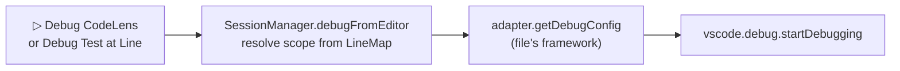

# Debugging: design

How the feature is built. What it does for users is in [Debugging](../../features/debugging.md); what it must do is in [the requirements](../../requirements/debugging.md), and the IDs below (D2, D5…) point there.

## Overview

## Key files

| File | Role |
|---|---|
| `src/framework/JestAdapter.ts` → `getDebugConfig` | Jest's JS entry point from the project root, CRA's extracted config, test-script flags, `--runTestsByPath`, an anchored `--testNamePattern`, `--runInBand --no-coverage`, Node options as `runtimeArgs` |
| `src/framework/VitestAdapter.ts` → `getDebugConfig` | `vitest.mjs run <file>`, the config, `-t <pattern>`, `--no-file-parallelism --test-timeout=0 --hook-timeout=0 --coverage.enabled=false`, `autoAttachChildProcesses` |
| `src/framework/PytestAdapter.ts` → `getDebugConfig` / `buildDebugConfig` | `type: debugpy`, `module: pytest`, the node id, the project's interpreter; checks the Python Debugger extension first (D5) |
| `src/extension.ts` → `debugFromEditor`, `src/session/SessionManager.ts` → `debugFromEditor` | Resolve the test or suite on the line, then ask the file's framework for the config and start it |

## How it works

1. The line is resolved to a test or suite through the file's `LineMap`. A suite debugs every test in it: the Jest pattern is anchored as `^(?:name)(?: |$)`, a single test as `^(?:name)$`.
2. The file's framework builds the launch config. The program is always a JS file, never `.bin/jest`, which is a shell script on Windows and can't be a debug program (D2). The working folder is the project root.
3. The run is a plain framework run: none of our instrumentation, coverage or reporters. The debugger steps through the user's code only, and the result is what the framework gives on its own.

## Design decisions

| Decision | Reason | Alternatives considered |
|---|---|---|
| Plain runs, no instrumentation | Stepping must show the user's code; our counters would show up in it | Debug the instrumented run |
| Jest in band | Breakpoints in workers need extra attach steps; one process is simple and reliable | Workers with auto-attach |
| Vitest with auto-attach and no timeouts | Vitest always uses workers; a test paused at a breakpoint must not time out | Run in one thread: differs from the user's config |
| pytest through the Python Debugger | It is the standard Python debugger in VS Code, and the user's interpreter runs it | Our own debug adapter |

## Testing

- e2e: `basic-debug` (Jest, a path with spaces, the config replayed with plain Node), `vitest-debug`, `pytest-debug`, `cra-app`.
- Gaps: the test script's flags and Node options in debug configs (D6), debugging without a session (D7).
