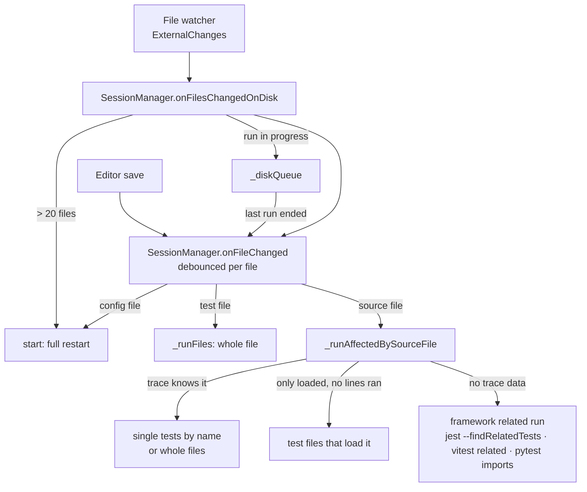

# On-save reruns: design

How the feature is built. What it does for users is in [On-save reruns](../../features/on-save-reruns.md); what it must do is in [the requirements](../../requirements/on-save-reruns.md), and the IDs below (S3, S14…) point there.

## Overview

## Key files

| File | Role |
|---|---|
| `packages/vscode-extension/src/session/SessionManager.ts` | `onSave`, `onFileChanged`, `onFilesChangedOnDisk`, `_runQueuedDiskChanges`, `_runAffectedBySourceFile`, `_runAffectedWith`, `_runTestCases` |
| `packages/vscode-extension/src/session/ExternalChanges.ts` | Turns file-watcher events into "changed on disk" batches: drops the editor's own saves, unsaved documents, `node_modules` and `.git`; groups events for 500 ms |
| `packages/vscode-extension/src/store/ExecutionTraceStore.ts` | `getAffectedTestFiles`, `getSuiteInfo`, `getDependentTestFiles`: source file → the tests that ran it |
| `packages/vscode-extension/src/session/instrumentation/shared/testDiscovery.js` | Marks a `describe` block whose tests share variables (`isSharedVars`) |
| `packages/vscode-extension/src/framework/FrameworkServices.ts` | Per framework: `isConfigFile`, `traceOffReason`, `batchRunner.runRelated`, `batchPolicy.maxParallel` |

## A save, step by step

1. **Guard (S1).** `onFileChanged` returns at once unless the session is on. Files outside the project, in `node_modules`, or that are not project source or a possible config are ignored.
2. **Debounce (S9).** One timer per file (`onSaveDebounceMs`). A new save of the same file restarts its timer. When it fires, the session token is compared with the one at save time; after a Stop or a restart the work is dropped.
3. **Config file (S7).** `_configFileOf` asks each framework's `isConfigFile`. A match calls `start()`, which re-reads the config and the runnable-file list and reruns everything.
4. **Mixed projects (S10).** `services.fileChanged` re-places the file with a framework (its imports may have changed).
5. **Test file (S2, S8).** If the framework's runnable list doesn't know the file, it is asked again once (a file created after Start). A file the config doesn't run is ignored. Otherwise `_runFiles([file])`.
6. **Source file (S3–S6).** The coverage for the file is marked stale (S16), then `_runAffectedBySourceFile` picks the tests, in this order:
   1. **Trace:** `getAffectedTestFiles` lists the test files whose tests ran a line of the file. Per suite: `isSharedVars` → the whole file (S4); a suite that ran no test cases (an empty `test.each`) → the suite by name; otherwise each test by its full name. Single tests go to `_runTestCases`: one process per test file with a combined name pattern, at most the budget's number of processes at once (Q2).
   2. **Loaded but not run:** the module graph says a test loads the file (a `?raw` import, CSS module): those test files run whole.
   3. **Used by name, not import (S6):** an asset nothing imports (Angular `templateUrl`) is replaced by the source files next to it that name it, each handled like a save, one level deep.
   4. **Related run (S5):** no trace data, or the framework's trace is off for this root (`traceOffReason`). Vitest uses a live `vitest related` batch; Jest uses `--findRelatedTests`; pytest finds the test files that import the module.
7. **End of run.** The stale mark is cleared whatever happened (S16). An empty result logs "no tests depend on this file" (Q3). `_endRun` announces "finished" only when no other run is in flight (S15).

## Changes on disk

`onFilesChangedOnDisk` handles what the watcher reports. Tests that write files are the main hazard: their writes would trigger reruns, which write again, without end (S14). The guards:

| Situation | What happens | Why |
|---|---|---|
| A run is in progress | The files go to `_diskQueue`; `_runQueuedDiskChanges` handles them when the last run ends (S13) | Rerunning mid-run would mix results |
| A file was last modified while our runs were going (`_writtenDuringLastRuns`, by its mtime) | Handled as changed during the run, even though the watcher reported it after the run ended | The watcher batches events, so a run's last writes arrive late |
| A queued file changes again during its own rerun (`_lastDiskRerun`) | Not rerun again; a WARN says so | A test is writing it |
| A file written during a run that no test ran or loaded (`_unusedByLastRun`) | Ignored | It is the tests' output, not their input |
| A test file the config doesn't run | Ignored | Fixtures that tests write |
| More than 20 files (`MAX_DISK_CHANGES_PER_FILE`) while idle | Full restart (S12), unless the same set triggered the last restart (`_lastDiskRestart`) | A branch switch: a rerun per file would be slower than one full run |
| More than 20 files written during a run | No rerun, an INFO line says why | Restarting would write them all again, forever |

## Design decisions

| Decision | Reason | Alternatives considered |
|---|---|---|
| Pick tests by the **execution trace** first, the import graph second | The trace knows which tests ran the changed code, not just which files import it. On large suites that is a few tests instead of many files | Import graph only (what `jest --watch` does): simpler, but reruns whole files |
| Whole file for a suite whose tests **share variables** | A test can depend on state another test set up; running it alone could pass or fail differently | Always single tests (fast but wrong), always whole files (correct but slow) |
| **Restart** on a config save | The config decides which files are tests and how they run. Patching the current state is error-prone | Rerun only affected files |
| **Debounce per file**, not globally | Format-on-save and "save all" touch many files at once; each still gets its own run | One global debounce |
| Attribute late watcher events by **file mtime** | A time window after the run also matched real changes (a `git pull` right after a run) | Ignoring events for N seconds after a run |

## Testing

- e2e: `basic-on-save`, `basic-config-save`, `basic-save-during-run`, `disk-changes`, `vitest-session`, `vitest-related`, `vitest-trace`, `pytest-on-save`, `pytest-related`, `mixed-on-save`, `coverage-editing`. The table in [the requirements](../../requirements/on-save-reruns.md) maps each requirement to its scenarios.
- Unit: the batch queue, `vanishedFile`, the trace store.
- Gaps: shared-variable suites (S4) and the debounce (S9) have no automated test yet.

## Known limits

- Jest and Vitest select single tests with a name pattern, so tests whose names overlap can run together.
- A file read with `fs` is not linked to the tests that read it.
