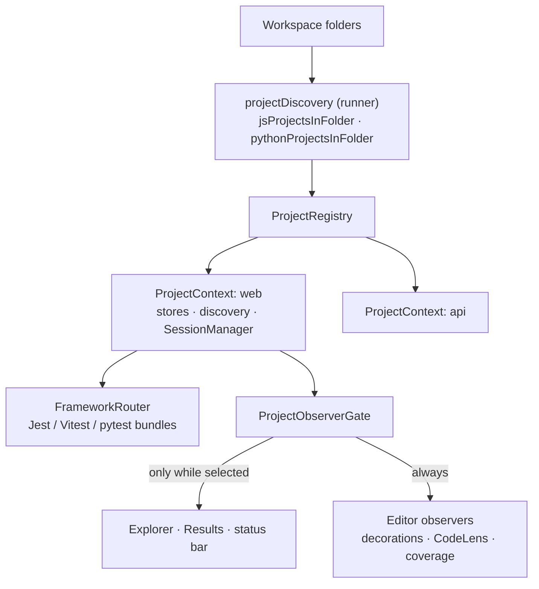

# Monorepos and mixed frameworks: design

How the feature is built. What it does for users is in [Monorepos and mixed frameworks](../../features/projects.md); what it must do is in [the requirements](../../requirements/projects.md), and the IDs below (P1, P15…) point there.

## Overview

## Key files

| File | Role |
|---|---|
| `packages/runner/src/framework/projectDiscovery.ts` | Pure detection of projects per folder (JS and Python rules), unit-tested |
| `packages/runner/src/framework/frameworkRouting.ts` | `projectFrameworks` (which frameworks a root configures), `assignFrameworks` (which one runs each file) |
| `src/project/ProjectRegistry.ts`, `ProjectContext.ts` | One context per project; the selected project; `forFile` |
| `src/project/projectLimits.ts` | `maxRunningProjects` and its `auto` value |
| `src/framework/FrameworkRouter.ts` | Per project: builds only the framework bundles it uses and answers `servicesFor(file)` |
| `src/editor/FileStores.ts` | Lets editor features find a file's own project |
| `src/python/PythonInterpreters.ts`, `pythonEnvChip.ts` | Which Python runs a pytest project, and the chip that shows it |

## How it works

### Detection (P1–P7)

For each workspace folder:

1. A folder with its own test config is one project; its config already covers its packages.
2. Else a monorepo root (`pnpm-workspace.yaml`, `package.json#workspaces`) gives one project per package with tests.
3. Else the folder, if a framework is detected.

Python follows the same shape: a folder that configures pytest is one project; else a uv workspace root gives one per member with tests; else the folder if it is a pytest project. A folder with no Python of its own is searched two levels down for pytest projects. A folder both families claim is one JS project whose router also runs pytest. Projects inside another project of the same family are dropped.

Nothing runs on open (P7). Only the selected project starts discovery; others discover when selected, when one of their files opens, or on Start.

### Per project

Everything that holds state is per project: the result, trace and coverage stores, discovery and its cache, the framework bundles and their batch runners, the `SessionManager`, and a sub-folder of the window's session folder. The window shares the views, decorations, output channels and status bar.

Each project's `SessionManager` notifies one `ProjectObserverGate`. It records the project's state for the switcher and forwards events to the views only while the project is selected (P8). Editor observers get every project's events, and draw each file from its own project (P9).

### Mixed frameworks (P15–P20)

`FrameworkRouter.prepare()` (every Start) finds the main framework and whether the root is mixed: a Jest marker plus a Vitest config of its own, or a pytest config in a JS folder. It then lists files with each framework in parallel and places each file once (`assignFrameworks`): the setting, then the lists, then the file's imports (`vitest` / `vi.` → Vitest, `@jest/globals` / `jest.` → Jest), then the main framework with one warning. Placements from a file's content are checked again when the file is saved (P16).

`SessionManager` queues batches per framework, never mixed (P17). A source save reruns each framework's dependents with an `owns` filter, so a result for another framework's file is ignored. Any framework's config restarts the session. Stop kills every bundle's batch runner (P20).

## Design decisions

| Decision | Reason | Alternatives considered |
|---|---|---|
| One `SessionManager` per project | Run bookkeeping (Stop token, active runs, progress, save timers) is per session by nature; single-project code paths stay unchanged | One manager over many contexts: a rewrite, and shared state between projects |
| A root with its own config is never split | Its config already runs its packages; splitting would run tests twice or with the wrong config (P1) | One project per package always |
| Detect, never auto-start; cap running projects | A monorepo with 30 packages must not start 30 runners (G4, G5) | Start all |
| Editor features per file, views per selection | The file you look at always shows its own results | Everything follows the selection: wrong icons in other packages' files |
| Place each test file with exactly one framework | A file run by both would show two results, one of them wrong | Run with both and merge |

## Testing

- e2e: `monorepo-select`, `monorepo-run`, `monorepo-stop`, `mixed-monorepo`, `mixed-full-run`, `mixed-on-save`, `mixed-stop`, `mixed-js-python`, `mixed-js-python-monorepo`, `multi-root-js-python`, `pytest-monorepo`, `pytest-venv-per-service`.
- Unit: `projectDiscovery`, `frameworkRouting`, `frameworkRouter`, `projectLimits`, `pythonEnvChip`.
