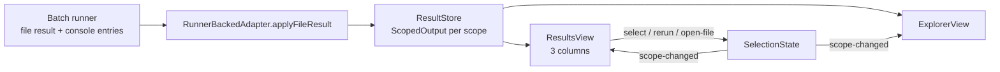

# Results panel: design

How the feature is built. What it does for users is in [Results panel](../../features/results-panel.md); what it must do is in [the requirements](../../requirements/results-panel.md), and the IDs below (R3, R4…) point there.

## Overview

## Key files

| File | Role |
|---|---|
| `src/views/ResultsView.ts`, `src/webview/views/resultsView.js` | The panel: test list, output (level tabs), errors |
| `src/views/copyText.ts` | The texts of Copy all, Copy for AI and Copy Failing Test Names (R11); `ResultsView.copyFailures` writes them to the clipboard (`vscode.env.clipboard`) |
| `src/webview/utils.js` | The shared copy icon and button (`copyButton`, `copyText`, `showCopied`) (R10) |
| `src/views/BaseWebviewProvider.ts` | Webview lifecycle, message routing, the observer base |
| `src/store/ResultStore.ts` | `ScopedOutput` on files and nodes; failure messages |
| `src/framework/RunnerBackedAdapter.ts` | Maps a framework's file result into the store: suites, templates, scoped reruns, output attribution |
| `packages/runner/src/framework/vitestReporter.ts` | Our Vitest reporter: records each console call with the task that made it |
| `packages/runner/src/framework/pytest/ltr_pytest.py` | The shipped pytest plugin: per-test stdout, stderr and log records, failure text |

## Output attribution (R3–R5)

Every scope (file, suite, test) has a `ScopedOutput { lines, capturedAt }`. `capturedAt: null` means "never run at this scope", which the panel shows as a placeholder.

| Framework | What the runner reports | What the store gets |
|---|---|---|
| Jest | Console output per file only | A whole-file run sets the file's output. A scoped rerun (`--testNamePattern`) sets that scope's output and keeps the file's full output (R5) |
| Vitest | Each console entry with its `scope` and `scopeName` | Every test that ran gets exactly its own lines, possibly none; a suite gets its hooks' lines; a whole-file run gives the file every line |
| pytest | Per test from the plugin | Each test its own output; the file all of it |

Output is never copied from a file into its tests (G7). Copying would show lines the test didn't print.

## Messages

The extension host and the webviews talk through `postMessage`. The main messages are `full-file-result` (a file's tree), `files-rerunning`, `scope-changed` (selection) and `scope-logs` (output and errors of the selected scope), plus `select`, `rerun`, `open-file` and `ready` from the webview. `scope-logs` is separate from `scope-changed` because they change at different times: re-rendering the output on every selection highlight would be wasted work.

## Design decisions

| Decision | Reason | Alternatives considered |
|---|---|---|
| A custom webview instead of VS Code's Test Results | On macOS the built-in panel shows "did not report any output" for tests that did; a webview also allows the three-column layout | The Testing API: less code, but the bug and its fixed layout |
| Output stored per scope, with a placeholder when never run | Only attributed output is true | Back-fill the file's output into each test: shows lines a test didn't print |
| One shared `SelectionState` | The sidebar, the panel and `◈ Results` always agree | Each view tracks its own selection |
| Views are kept alive when hidden (`retainContextWhenHidden`), and a re-created view asks with `ready` | A hidden view keeps receiving updates, so nothing is re-sent each time it is shown; re-sending the whole tree on every show was slow on large projects | Re-send everything when a view becomes visible |

## Testing

- e2e: `vitest-output`, `basic-on-save`, `basic-full-run`, `vitest-full-run`, `pytest-full-run`, `commands`.
- Unit: `resultStore`.
- Gaps: the webview's rendering (R1, R8) can't be read from the e2e host; the checks stop at the messages the views are sent.
