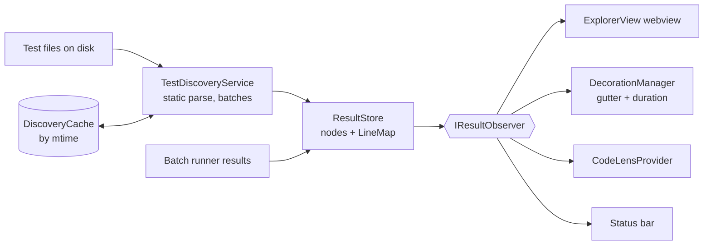

# Test Explorer and editor: design

How the feature is built. What it does for users is in [Test Explorer and editor](../../features/test-explorer.md); what it must do is in [the requirements](../../requirements/test-explorer.md), and the IDs below (E1, E9…) point there.

## Overview

## Key files

| File | Role |
|---|---|
| `src/session/TestDiscoveryService.ts` | Finds test files, parses them in batches, fills the `ResultStore`, watches for changes |
| `src/session/instrumentation/shared/testDiscovery.js` | The JS / TS parser: `describe` / `it` / `test`, `.each`, `.only` / `.skip`, template-literal names, shared-variable detection. Uses the project's Babel when present, else a bundled parser |
| `src/session/discovery/pythonDiscovery.ts` | The pytest scanner: `python_files` under `testpaths`, `Test*` classes, `unittest.TestCase`, `parametrize` templates. A line scanner, no Python needed |
| `src/cache/DiscoveryCache.ts` | Per-project cache of parse results keyed by file mtime; LRU capped at 10 projects / 500 MB |
| `src/store/ResultStore.ts` | Flat node pool (`Map<id, TestNode>`) with `parentId` / `children`; status bubbles up; `LineMap` per file |
| `src/views/ExplorerView.ts`, `src/webview/views/testListView.js`, `src/webview/testListLayout.js` | The sidebar tree, score cards, filters, search |
| `src/editor/DecorationManager.ts` | Gutter icons and inline durations |
| `src/editor/CodeLensProvider.ts` | `▶ Run` / `▷ Debug` / `◈ Results` lenses |
| `src/editor/failureInfo.ts` | Reads a failure message: summary, stack frames / `file:line` locations, expected and received (from `Expected:` / `Received:` or the `- Expected` / `+ Received` diff) (E13) |
| `src/editor/FailureDecorations.ts` | The message after the failing line, its hover (Show diff through a `ltr-failure:` document pair and `vscode.diff`, Open in Results, Dismiss), hidden on edited lines (E13, E14) |

## How it works

1. **Discovery at activation (E1).** The selected project's discovery starts when the extension activates, before Start. Files are parsed 5 at a time with an empty cache and 25 at a time with a warm one, yielding to the event loop between batches (Q1).
2. **Cache (E5).** Each entry is `{ mtime, result }`. On load, entries whose file changed or vanished are dropped, and only those files are parsed again (Q2).
3. **Into the store.** Each discovered suite and test becomes a `TestNode` with id `{file}::{suite}::…::{name}`. Dynamic names become `template` nodes, which stay even with no cases (E3) and are ignored by status roll-ups so an empty template doesn't make its parent pass or fail.
4. **LineMap.** Each file's map holds `line → { nodeId, fileId }`: identity only, never status. Decorations read the node's status from the store when they draw, so they can't go stale. After a run, the framework's own `location.line` replaces the parsed line (E12).
5. **Runnable files (E6).** On Start the framework lists the files it runs (`jest --listTests`, `vitest list`, `pytest --collect-only`). Files it lists that discovery missed are added; discovered files it doesn't list are marked excluded and shown as skipped, not as failed.
6. **Watcher (E4).** A created, changed or deleted test file is re-parsed and its nodes replaced, except while it is running (the result will replace them anyway).
7. **Editor.** `DecorationManager` and `CodeLensProvider` are editor observers: they draw every visible file from its own project's store, whatever project is selected. CodeLens finds blocks with a line regex, not a parse, so it stays cheap on every keystroke.

## Design decisions

| Decision | Reason | Alternatives considered |
|---|---|---|
| Parse files statically instead of asking the framework | The tree is there instantly and costs no test process; `--listTests` only gives file names | Run the framework's collection on open: slow and starts processes before the user asked (G5) |
| A flat node pool with parent links | O(1) lookup by id for every result; any nesting depth (E2) | A nested object tree: lookups walk the tree |
| LineMap stores identity only | One source of truth for status; nothing to keep in sync | Status in the map: goes stale |
| Discovery on activate, not on Start | Start only has to run tests | Discover on Start: the tree is empty until then |
| Regex for CodeLens | Cheap, runs on every edit; line-level accuracy is enough | Full parse per keystroke |
| Placeholders for discovered tests that got no result are cleaned when the file's result arrives | The tree matches what really ran (`.each` cases, renamed tests) | Keep both: stale entries |
| Failure lines from the failure text, not from structured errors | One parser for Jest's messages, our Vitest error text and pytest's report; the Results panel shows the same text | Per-framework structured errors (Jest `failureDetails`, Vitest `errors`): three code paths |
| Mark the innermost project frame and the test's own frame | The line that threw and the line of the test that led there are the two a reader looks for | Only the test line: an error thrown in the code under test would point at the call |
| An edited line shows no message (the line's text is remembered when first shown) | A message on the wrong line is worse than none, as with coverage bars | Move messages with edits |

## Testing

- e2e: `basic-full-run`, `basic-on-save`, `basic-running-count`, `basic-scoped-run`, `pytest-full-run`, `mixed-js-python`.
- Unit: `testDiscovery`, `pythonDiscovery`, `resultStore`, `testNames`, `statusFilter`, `duration`, `runnableFiles`.
- Gaps: the cache's mtime keying (E5) and the switch to the framework's line numbers (E12).
