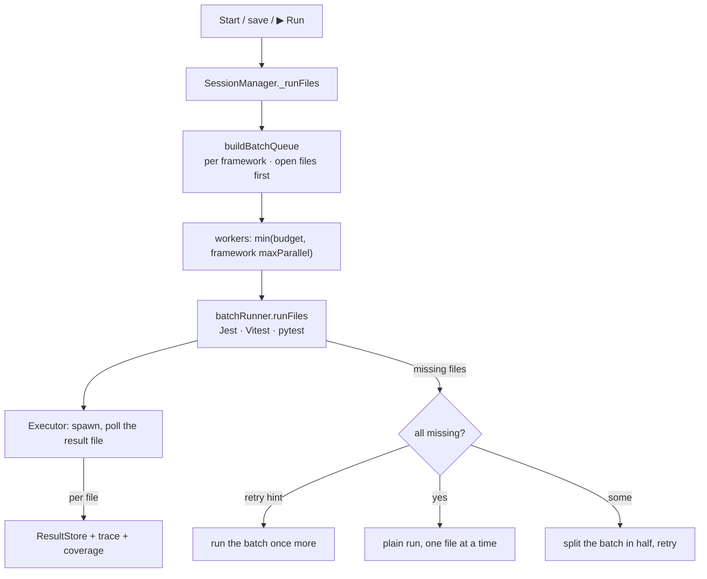

# Test runs: design

How the feature is built. What it does for users is in [Test runs](../../features/test-runs.md); what it must do is in [the requirements](../../requirements/test-runs.md), and the IDs below (T2, T6…) point there.

## Overview

## Key files

| File | Role |
|---|---|
| `src/session/SessionManager.ts` → `_runFiles`, `_runTestCases` | Batches, workers, retries, fallbacks, progress, Stop token |
| `src/session/batchQueue.ts` | `buildBatchQueue` (per framework, open files first), `promoteInQueue` (T2) |
| `packages/runner/src/AngularRunner.ts`, `framework/adapters/AngularAdapter.ts`, `framework/angularWorkspace.ts` | Angular: `ng test <project>` with `--include` / `--filter` / `--list-tests`, our reporters, a runner config in the session folder (`includeTaskLocation`, `update`, coverage folder from `LTR_NG_COVERAGE_DIR`), `CI=true` (Angular's build cache off). Reads `angular.json` for the projects tested with the unit-test builder (T14) |
| `src/session/AngularBatchRunner.ts`, `jsImporters.ts` | Splits a batch by Angular project over `VitestBatchRunner`; saves rerun the importing test files (T15) |
| `src/session/JestBatchRunner.ts`, `VitestBatchRunner.ts`, `PytestBatchRunner.ts` | One framework process per batch with our reporter / plugin, a temp config, streamed results, hang detection |
| `src/session/IBatchRunner.ts` | The contract: `runFiles` returns `{ missing, retry? }` |
| `src/framework/FrameworkServices.ts` → `batchPolicy` | Per framework: `maxParallel` (pytest: 1), `maxFilesPerBatch` |
| `packages/runner/src/execution/` | Spawning, killing the process tree, the result file |
| `src/cache/Storage.ts` | Every cached path, Clear Cache, pruning after 30 days (T12) |

## How it works

1. **Budget (T4, G4).** `CONCURRENCY = max(1, floor(cpus / 4))` workers. Jest batches run with `--maxWorkers=1`, so a batch is one process. A framework's `batchPolicy.maxParallel` caps its own processes (pytest: 1).
2. **Batches.** Files are grouped per framework (never mixed). Batch size is `max(5, min(50, ceil(files / CONCURRENCY)))`, so Jest's startup is shared across files while results still stream. Open test files form batches of their own at the front; `promote()` moves a file opened later to the front (T2).
3. **Streaming (T3).** Our Jest reporter, Vitest reporter and pytest plugin append one JSON line when a file starts and one when it ends. The batch runner polls that file every 200 ms. A file is marked running only on its start record.
4. **Hangs (T5).** Per-test heartbeats from the reporter or plugin. A test past `hangTimeoutSeconds` stops the batch; its file is failed with the reason; the batch's unfinished files run again. A worker that never reports a test start is stopped after three times the limit without progress.
5. **No result (T6, T7).** `runFiles` returns the files that got no result. If the runner gives a `retry` reason (a file vanished mid-scan), the batch runs once more. If every file is missing, they fall back to a plain framework run, one at a time within the budget. If only some are missing, the batch is split in half and retried, down to a plain run of a single file.
6. **Stop (T8).** Stop increments the session token and kills every batch runner's process tree. Every retry, fallback and queued batch checks the token first, so nothing starts afterwards. Running files go back to their previous state.
7. **Same results as the terminal (T1, T10).** The project's own framework binary and config run; Jest gets a temp config that extends the project's (`jest --showConfig`), Vitest a wrapper config, pytest our plugin by `-p`. The test script's flags are read and passed on.

## Design decisions

| Decision | Reason | Alternatives considered |
|---|---|---|
| A quarter of the cores | Leaves the machine responsive while tests run (G4) | All cores: fastest, but the editor stutters |
| Batches, not one process per file | Framework startup is the main cost; batching shares it | One process per file: simple, slow |
| Results streamed from a file we poll | Works the same for all three frameworks and survives a crashed process | Parse stdout: interleaved and truncated on Windows |
| Fall back to plain runs | A config we can't instrument still gives results (G9) | Fail the batch |
| `spawn`, never `exec` | `exec` buffers output and truncates large runs | — |
| pytest one process at a time | Session fixtures, test servers on fixed ports and shared files assume it, as in the terminal | Parallel pytest: breaks those projects |
| Angular through the builder, not plain Vitest (T14) | Angular's tests need its compilation and TestBed setup; `vitest run` fails with `describe is not defined`. The builder takes our reporters and a runner config of our own | Generate a Vite config from angular.json: re-implements the builder |
| One `ng test` per Angular project | `ng test` with no name runs each project in turn, all writing the same result file | One command for the workspace |
| Coverage only with the project's provider | The builder prepares its build for the provider it finds in the project; a provider outside it measured nothing | Ship a provider (later research) |

## Testing

- e2e: `basic-full-run`, `basic-open-first`, `basic-hang`, `basic-stop`, `basic-save-during-run`, `basic-scoped-run`, `basic-clear-restart`, `vitest-batch`, `vitest-hang`, `vitest-stop`, `pytest-hang`, `pytest-stop`, `mixed-stop`, `esm-fn-config`, `ts-config`, `cra-app`, and the real-repo matrix.
- Unit: `batchQueue`, `vanishedFile`, `storage`, runner `executor`, `jestRunnerArgs`, `vitestRunnerArgs`.
- Gaps: the crashed-batch fallback (T6) is not triggered by any scenario.
