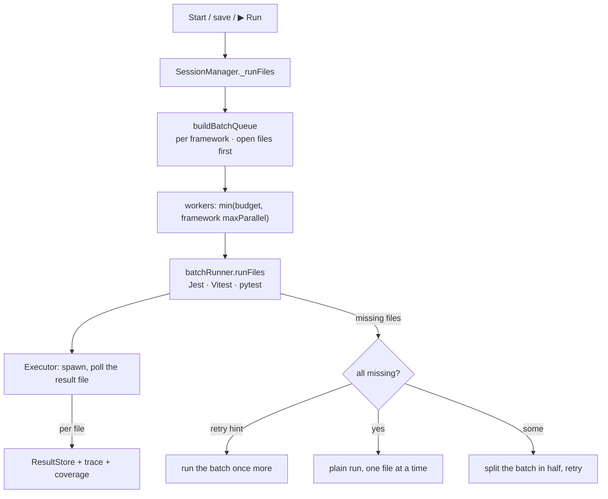

# Test runs: design

How the feature is built. What it does for users is in [Test runs](../../features/test-runs.md); what it must do is in [the requirements](../../requirements/test-runs.md), and the IDs below (T2, T6…) point there.

## Overview

## Key files

| File | Role |
|---|---|
| `src/session/SessionManager.ts` → `_runFiles`, `_runTestCases` | Batches, workers, retries, fallbacks, progress, Stop token |
| `src/session/batchQueue.ts` | `buildBatchQueue` (per framework, open files first), `promoteInQueue` (T2) |
| `packages/runner/src/AngularRunner.ts`, `framework/adapters/AngularAdapter.ts`, `framework/angularWorkspace.ts` | Angular: `ng test <project>` with `--include` / `--filter` / `--list-tests`, our reporters, a runner config in the session folder (`includeTaskLocation`, `update`, coverage folder from `LTR_NG_COVERAGE_DIR`, `maxWorkers` within the budget: the builder has no flag for it), `CI=true` (Angular's build cache off). Reads `angular.json` for the projects tested with the unit-test builder (T14) |
| `src/session/AngularBatchRunner.ts`, `jsImporters.ts` | Splits a batch by Angular project over `VitestBatchRunner`; saves rerun the importing test files (T15) |
| `src/session/JestBatchRunner.ts`, `VitestBatchRunner.ts`, `PytestBatchRunner.ts` | One framework process per batch with our reporter / plugin, a temp config, streamed results, hang detection |
| `src/session/IBatchRunner.ts` | The contract: `runFiles` returns `{ missing, retry? }` |
| `src/framework/FrameworkServices.ts` → `batchPolicy` | Per framework: `maxParallel` (pytest: 1), `maxFilesPerBatch` |
| `packages/runner/src/execution/` | Spawning, killing the process tree, the result file |
| `src/cache/Storage.ts` | Every cached path, Clear Cache, pruning after 30 days (T12) |

## How it works

1. **Budget (T4, T16, T22, G4).** `totalWorkers()` from the speed level (`setSpeedLevel`, from `liveTestRunner.speed` in `extension.ts`): full `floor(3·cores/4)`, balanced `floor(cores/2)`, light `min(2, floor(cores/4))`, at least 1. `parallelBatches()` = `max(1, floor(total / 2))` batches at once (light: 1; balanced equals the old `floor(cores / 4)`) (runner `utils/resources.ts`). Read when a run starts, so a change applies from the next run. **Adaptive (T24, default):** unless `liveTestRunner.speedStrict` is on, the level is where the budget starts. Before each test process the scheduler asks `workersNow(ours)`: the machine's busy cores (from `os.cpus()` times, at least a second apart) less what our own test processes really used (every process below the extension host, from `ps` CPU times; on Windows each running worker counts as a busy core) are the other programs' share; the budget is every core they leave free but one, between Light's budget and `adaptiveCeiling()` (Full's, and no more than the physical cores but one: `sysctl hw.physicalcpu`, `/proc/cpuinfo`, Windows `Win32_Processor.NumberOfCores` asked in the background at activation (`primePhysicalCores`); never below the level's own). `maxBatchSlots()` gives the run as many slots as that ceiling, and each process is gated by its workers (`BatchPolicy.workersPerProcess`: Jest and pytest 1, Vitest / Angular `workersPerBatch()`), so Jest no longer uses half its share. The check reserves the process and its workers in the same step (`_batchesRunning`, `_workersRunning`): checked and counted after an await, every slot passed at once. The open files' batches start 1.5 s before the rest of a full run (`OPEN_FILES_HEAD_START_MS`: started together with five other Jest processes, the open file's result came 2 s later). Jest batches run with `--maxWorkers=1`, so a batch is one process. Vitest batches get `--maxWorkers=workersPerBatch()`: half the cores split across the parallel batches (at least 1), or the project's own lower limit (`maxWorkers`, a pool's `maxThreads` / `maxForks`, `fileParallelism: false`), which the config probe reads from the resolved config. Below Vitest 4 `--minWorkers=1` goes with it (a config `minWorkers` above the cap would crash the pool; Vitest 4 rejects the flag). Without the cap every batch started Vitest's default of cores − 1 workers. A framework's `batchPolicy.maxParallel` caps its own processes (pytest: 1). **Memory (T19):** before a batch or scoped rerun starts beside others, `SessionManager._memoryForAnotherBatch` asks `memoryLow(available, total, another)` (under min(2 GB, total / 5) free once `another` is taken off: the largest running test process with its workers, `largestTestProcessMemory()` from the same `ps` pass as the load (macOS / Linux); Sentry's Jest processes reached 1.4 GB each and 6 of them 8.4 GB on a 16 GB machine, from `process.availableMemory`, else `os.freemem` except on macOS, where it counts only wholly free pages); when low the batch goes back to the front of its queue and waits for a batch to end or 2 s. `_batchesRunning` counts every run in the window. **Priority (T20):** `Executor` calls `lowerPriority(child.pid)` right after spawning (`os.setPriority`, below normal); workers inherit it.
2. **Batches.** Before them, at Start: the framework's own list of the files it runs (`jest --listTests`, `pytest --collect-only`, Vitest's list), remembered per project until a test or config file changes. What Vitest's config resolves to (projects, coverage include / exclude, worker limit: the `vitestProjects` probe, ~1 s) is remembered too and used at once; a probe checks it in the background (T21). When the list is not remembered, the test files on screen start while it is made (T18; not in a mixed project, whose lists also route files to frameworks, and not with a budget of one process, since the list is a process too). A file the list then leaves out loses its results, coverage contribution and trace entries and is marked excluded. Files are grouped per framework (never mixed). Batch size (`batchSize` in `batchQueue.ts`) is 5 to 50 files (a framework may raise the top: `BatchPolicy.maxFilesPerBatch`: Angular 1000, since each `ng test` builds before a test runs (2,500 files: 98 s in 167-file batches, 71.5 s in one per process; plain `ng test --coverage` 56 s); pytest 300), chosen per framework so its batches fill whole rounds of its parallel batches (500 files, 3 at a time: 12 batches of 42, not 10 of 50 with a last round of one while the rest of the budget waits). A process's startup is shared across files while results still stream, and a crash or hang retries few files. Open test files form batches of their own at the front; `promote()` moves a file opened later to the front (T2).
3. **Streaming (T3).** Our Jest reporter, Vitest reporter and pytest plugin append one JSON line when a file starts and one when it ends. The batch runner polls that file every 200 ms. A file is marked running only on its start record.
4. **Hangs (T5).** Per-test heartbeats from the reporter or plugin. A test past `hangTimeoutSeconds` stops the batch; its file is failed with the reason; the batch's unfinished files run again. A worker that never reports a test start is stopped after three times the limit without progress.
5. **No result (T6, T7).** `runFiles` returns the files that got no result. If the runner gives a `retry` reason (a file vanished mid-scan), the batch runs once more. If every file is missing, they fall back to a plain framework run, one at a time within the budget. If only some are missing, the batch is split in half and retried, down to a plain run of a single file.
6. **Stop (T8).** Stop increments the session token and kills every batch runner's process tree. Every retry, fallback and queued batch checks the token first, so nothing starts afterwards. Running files go back to their previous state.
7. **Compile once (T17).** Jest names its transform cache and file map after the config file's path. The generated config is therefore one file per content hash in the project's transform-cache folder (`writeStableConfig`), and nothing in its text changes per batch or session: the reporter file and the resolved-config JSON come through the environment (`LTR_REPORTER_FILE`, `LTR_JEST_RESOLVED_CONFIG`). With a new path per batch, every batch re-instrumented every file and re-crawled the project (2,500 test files: 51 caches, 564 MB, full run 192 s; now one cache, 61 MB, about 115 s). Nor may anything the config *evaluates to* change per session: Jest copies options such as `coverageDirectory` into each project config, and that config is part of every file's transform cache key. `coverageDirectory` is therefore a fixed `jest-coverage` folder in the transform-cache folder, not the session folder (which recompiled the whole project on every Start: Sentry, 100 test files in one process 285 s → 188 s).
8. **Same results as the terminal (T1, T10).** The project's own framework binary and config run; Jest gets a temp config that extends the project's (`jest --showConfig`), Vitest a wrapper config, pytest our plugin by `-p`. The test script's flags are read and passed on.

## Design decisions

| Decision | Reason | Alternatives considered |
|---|---|---|
| A quarter of the cores | Leaves the machine responsive while tests run (G4) | All cores: fastest, but the editor stutters |
| Batches, not one process per file | Framework startup is the main cost; batching shares it | One process per file: simple, slow |
| Results streamed from a file we poll | Works the same for all three frameworks and survives a crashed process | Parse stdout: interleaved and truncated on Windows |
| Open files start before the runnable list on the first Start (T18) | `pytest --collect-only` takes 29–36 s on 2,500 files and nothing ran meanwhile; the open file is almost always runnable, and the rare one that is not is taken back. Both runs take their processes from one `BatchSlots` (`batchQueue.ts`): with their own limit each, a Vitest Start ran four batches at once on a budget of three | Wait for the list (first result after half a minute); run every discovered file (runs files the config excludes) |
| The Vitest config answer is used from the last session, then checked | Start waited for the probe (0.75–1.2 s on 500 files, 2.8–4.8 s on heavier configs) before the first batch; the stamp (config, package.json, installed Vitest) cannot see files a config imports, so a background probe corrects it for the rest of the session | Wait for the probe every Start; trust the stamp alone (a changed imported file would stay wrong) |
| Speed levels, default balanced (no battery mode) | One setting covers "my laptop heats up" and "use the whole machine" without breaking zero config: the default is today's budget. Battery mode would need the power state from the OS (a new read): left out for now | A worker-count setting (users would have to know their cores); automatic levels from power state |
| The level is where the budget starts, adapting by default; `speedStrict` keeps it | A level as a hard cap leaves an idle machine half used; adapting to other programs' load keeps the user's work first and uses what is free. Measured on 6 cores / 12 threads, 2,500 files: Jest 110–116 s strict → 96–98 s adaptive, Vitest about the same; with 8 busy programs the run kept 2–4 processes instead of 6 | The level as a cap (the owner's call: an idle machine would never go high); logical cores as the ceiling (9 Jest processes on 6 cores: no faster, three times the memory) |
| Test processes below normal priority; memory gates extra batches, not a lower budget | Priority costs nothing on an idle machine and gives the user the CPU when they need it; the memory gate slows only a machine short of memory (Sentry, 16 GB: 3 Jest processes reached 6.1 GB and the machine swapped 9 GB) | A smaller budget for everyone (slower on every machine); a speed setting (adds config; a later option) |
| Generated Jest config named by its content hash, per-run paths in the environment (T17) | Jest's cache id is the config path: one stable path = one cache shared by every batch and session; a changed text = a new file, so stale code is never served | Set Jest's `id` in the config (an internal option, not accepted by every Jest version); one fixed file name (two windows with different extension versions would overwrite each other's config) |
| Fall back to plain runs | A config we can't instrument still gives results (G9) | Fail the batch |
| `spawn`, never `exec` | `exec` buffers output and truncates large runs | — |
| pytest one process at a time | Session fixtures, test servers on fixed ports and shared files assume it, as in the terminal | Parallel pytest: breaks those projects |
| Angular through the builder, not plain Vitest (T14) | Angular's tests need its compilation and TestBed setup; `vitest run` fails with `describe is not defined`. The builder takes our reporters and a runner config of our own | Generate a Vite config from angular.json: re-implements the builder |
| Angular batches up to 200 files, Vitest workers capped in the runner config | Every `ng test` builds its files first (~7 s before a test runs), and left alone Vitest starts a worker per core in each batch. 2,500 test files: 52 batches of 49 with uncapped workers took 528 s; 16 batches with 2 workers each, 124 s (plain `ng test --coverage`: 49 s) | Vitest's default batch size; one `ng test` for the whole run (no results until the build is done, a crash reruns everything) |
| One `ng test` per Angular project | `ng test` with no name runs each project in turn, all writing the same result file | One command for the workspace |
| Coverage only with the project's provider | The builder prepares its build for the provider it finds in the project; a provider outside it measured nothing | Ship a provider (later research) |

## Testing

- e2e: `basic-full-run`, `basic-open-first`, `basic-hang`, `basic-stop`, `basic-save-during-run`, `basic-scoped-run`, `basic-clear-restart`, `vitest-batch`, `vitest-hang`, `vitest-stop`, `pytest-hang`, `pytest-stop`, `mixed-stop`, `esm-fn-config`, `ts-config`, `cra-app`, and the real-repo matrix.
- Unit: `batchQueue`, `vanishedFile`, `storage`, runner `executor`, `jestRunnerArgs`, `vitestRunnerArgs`.
- Gaps: the crashed-batch fallback (T6) is not triggered by any scenario.
