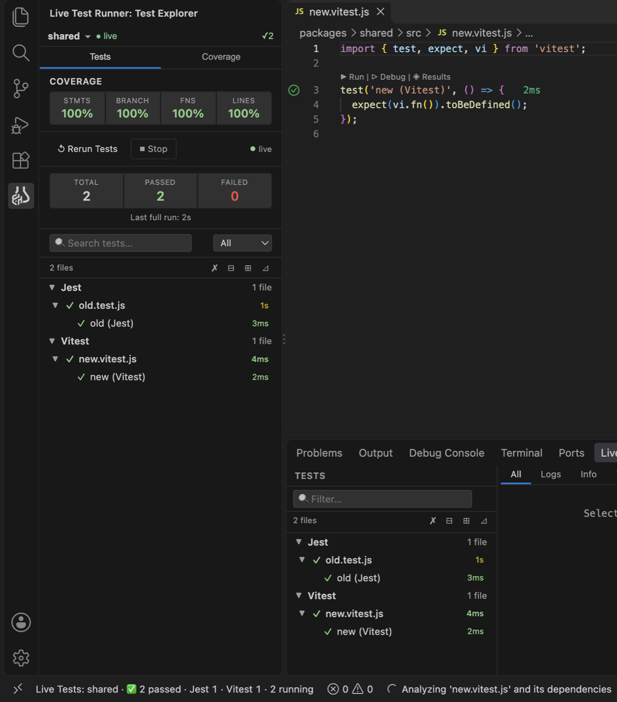
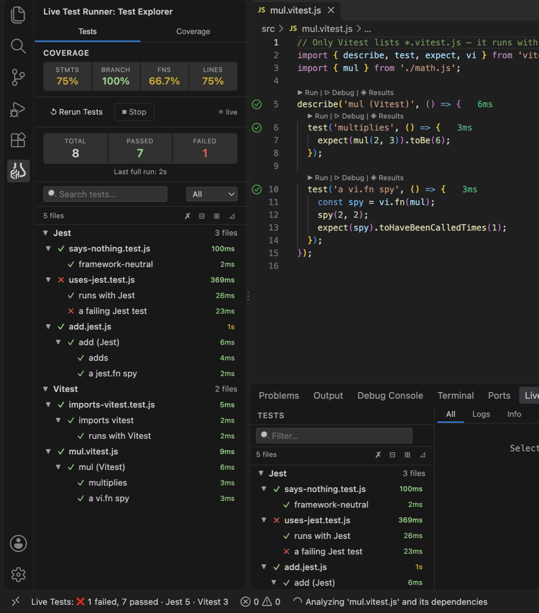
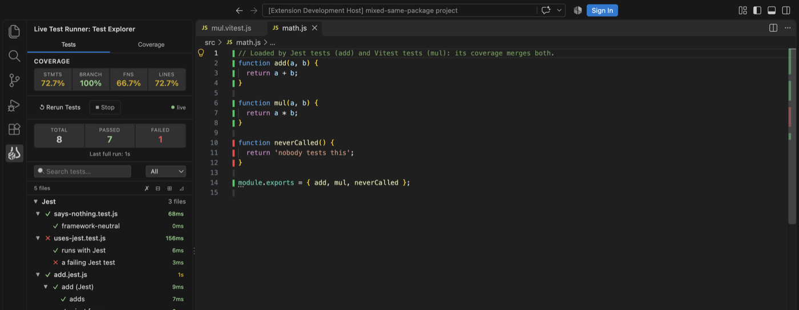

<!-- # Live Test Runner  -->

  <b>
    Live Test Runner
    
  </b>

> Save a file. Tests run. Results appear inline. No terminal. No config.

> **Works with Jest (incl. Create React App), Vitest and pytest** — see [Supported frameworks](#supported-frameworks) for what each one supports.

🌐 **[Website](https://eshandias.github.io/live-test-runner/)** · 📖 **[Read the full guide](https://eshandias.github.io/live-test-runner/guide/)** — or run **Live Test Runner: Open Guide** in VS Code.

<!-- [TODO: USER_INPUT_NEEDED] Replace with an updated hero gif showing the full experience (test run + coverage bars + hover) -->

---

## What you get

| | Feature | |
|---|---|---|
| ⚡ | **Live reruns on save** — targeted, file or test level | |
| 🌳 | **Test tree in the sidebar** — file → suite → test, instant on open | |
| 🎨 | **Editor decorations** — gutter icons, inline duration, CodeLens buttons | |
| 📊 | **Per-line code coverage** — coloured bars + hover shows which tests hit each line | |
| 🔍 | **Results panel** — 3-column view: test list · console output · errors | |
| 🗂 | **Monorepos & multi-root workspaces** — every package is a project; switch between them, run several at once | |
| ⏱ | **Timeline Debugger** *(coming soon)* — step through a test like a time-travel debugger | |

---

## Quick Start

1. Open a Jest, Vitest or pytest project in VS Code
2. Click the **beaker icon** in the Activity Bar
3. Click **▶ Start Testing**
4. Save any file — results update instantly

> No config changes. No extra installs. The framework is detected from your project — for pytest, so is its virtual environment.

---

## Features

### Test tree & always-on watching

Your full suite — every file, suite, and test — appears in the sidebar on project open before any run. Tests rerun on every save. The status bar shows a live pass/fail count.

<!-- [TODO: USER_INPUT_NEEDED] Short gif: sidebar tree populating on open, then a test going red/green on save -->

---

### Editor decorations & CodeLens

Every `it()` / `test()` line gets a gutter icon, inline duration, and action buttons:

- ✓ / ✗ / ⟳ / ○ gutter icons — live from project open
- `▶ Run` · `▷ Debug` · `◈ Results` CodeLens above each block
- Inline duration label, color-coded by threshold

<!-- [TODO: USER_INPUT_NEEDED] Screenshot or short gif of gutter icons + CodeLens in action -->

---

### Live code coverage

After the first run, every source file shows per-line coverage — no separate command needed.

| Bar | Meaning |
|-----|---------|
| Green `▌` | Covered by all tests |
| Amber `▌` | Covered by some tests |
| Red `▌` | Never executed |
| Grey `▌` | Not executable |

Hover any line to see which tests cover it, their pass/fail status, and duration (Jest and Vitest). When more than 5 tests cover a line, click **Show all N** to open a searchable Quick Pick listing every covering test — select one to jump to its result. Coverage updates on every save; files show a grey overlay while a rerun is in progress.

<!-- [TODO: USER_INPUT_NEEDED] Screenshot or gif of coverage bars + hover tooltip in a source file -->
<!-- [TODO: USER_INPUT_NEEDED] Screenshot: coverage bars + hover listing the covering tests on a Vitest project (with @vitest/coverage-v8 installed) -->

---

### Monorepos & multi-root workspaces

- Every package with tests is detected as its own project — nothing runs until you start it.
- A **project switcher** at the top of the Explorer shows each project's state (`● running`, `● live`, ✓ / ✗ counts). Pick one: the tree, results and status bar switch to it. Gutter icons, CodeLens and coverage bars always show each file's own project.
- **▶ Start / ⏹ Stop act on the project shown.** Others keep running (and rerunning on save) in the background.
- A root config that already covers its packages (Jest `projects`, Vitest `test.projects`) stays one project; Vitest projects are grouped by name in the tree.
- `maxRunningProjects` limits how many run at once.

<!-- [TODO: USER_INPUT_NEEDED] optional gif: open the switcher, start two packages, switch between them while both run -->

---

### Jest and Vitest in one project

Migrating from Jest to Vitest? A project with a Jest config **and** its own `vitest.config.*` runs **each test file with its own framework**:

- Only one config lists the file → that framework.
- Both list it → Vitest if it imports from `vitest` or calls `vi.`, Jest if it imports `@jest/globals` or calls `jest.`; otherwise Jest, with one warning in the log.
- Override with `liveTestRunner.frameworks`, e.g. `{ "packages/new/**": "vitest" }`.

The tree groups files by framework, saves rerun both frameworks' related tests, and coverage merges both.

---

### pytest (Python)

Open a Python project and **Start Testing** — same tree, gutter icons, CodeLens, coverage and live reruns as for Jest and Vitest.

- **Your environment, untouched:** the project's `.venv` / `venv`, poetry or pipenv env (or the Python extension's choice) runs the tests. **Select Python Interpreter** picks another; nothing is installed into it.
- **Same results as `pytest` in your terminal** — your `pyproject.toml` / `pytest.ini` / `tox.ini` / `setup.cfg`, `addopts` and conftest fixtures apply, one pytest process at a time.
- **Per-test output** — each test shows its own `print`, stderr and logging; failures show pytest's own explanation.
- **▶ Run / ▷ Debug** one test, class or parametrized function (by node id). Debug uses the Python Debugger extension.
- **Coverage and covering tests** with the project's own `coverage` settings (pytest-cov not needed): saving `src/cart.py` reruns exactly the tests that ran it.
- Nothing is written into your project: no `.pytest_cache` changes, no `.coverage`, no `htmlcov`.

<!-- [TODO: USER_INPUT_NEEDED] gif: Start Testing on a pytest project — tree fills in, results and gutter icons appear, a per-test print in the Results panel, saving a source file reruns only its tests -->

Needs pytest 7 or newer on Python 3.12 or newer (`coverage` for coverage).

---

### Results panel

3-column view: test tree with search · console output tabbed by level · failure messages and stack traces.

<!-- [TODO: USER_INPUT_NEEDED] Screenshot of the 3-column results panel -->

---

### Timeline Debugger *(coming soon)*

Step through any test case line by line — variable values as inline ghost text, watch panel, call stack, no breakpoints needed.

<!-- [TODO: USER_INPUT_NEEDED] Preview gif or screenshot of timeline debugger once available -->

---

## Commands

| Command | What it does |
|---------|-------------|
| `Start Testing` | Run all tests and start watching |
| `Stop Testing` | End the session |
| `Stop Testing and Clear Cache` | Stop + wipe discovery cache |
| `Clear Cache and Restart Testing` | Fresh restart |
| `Select Project` | Switch the project shown (same as the Explorer's switcher) |
| `Select Project Root` | Pin Live Test Runner to one folder (or back to all projects) |
| `Select Python Interpreter` | pytest projects: choose the Python environment that runs the tests (remembered per project) |
| `Stop All Projects` | Stop every running project |
| `Show Logs` | Open the extension log (filter by level) |
| `Show Test Output` | Open the raw test-runner output |
| `Copy Diagnostic Report` | Copy versions, setup and recent logs for a bug report |
| `Open Guide` | Open the user guide in an editor tab |

> **Tip:** Shift-click **⏹ Stop** to stop and clear cache in one click.

---

## Troubleshooting

- **Output → "Live Test Runner"** — what the extension did: one line per run, warnings when something falls back. Set the level to **Debug** (⚙ in the Output panel) for details.
- **Output → "Live Test Runner: Test Output"** — exactly what Jest / Vitest printed.
- Reporting a bug? Run **Copy Diagnostic Report** and attach it.

<!-- [TODO: USER_INPUT_NEEDED] Screenshot of the Output panel showing the levelled "Live Test Runner" log with a Run summary line -->

---

## Configuration

All settings under `liveTestRunner.*`.

| Setting | Default | Description |
|---------|---------|-------------|
| `projectRoot` | `""` | Pin to one project root; empty = detect every project in the workspace |
| `maxRunningProjects` | `"auto"` | Projects running at once: `auto` = 2 (1 on ≤ 4 cores or < 8 GB total memory), or a number |
| `runMode` | `"auto"` | `"auto"` calls Jest directly; `"npm"` delegates to `npm test` (Jest only) |
| `jestCommand` | `""` | Override Jest binary path |
| `vitestCommand` | `""` | Override the Vitest command (e.g. `npx vitest`); empty = the project's own Vitest |
| `frameworks` | `{}` | Jest + Vitest projects: glob → `"jest"` / `"vitest"` for those test files |
| `vitestTrace` | `true` | Vitest execution trace: covering tests on hover, and saves rerun only the tests that ran the file |
| `vitestIncludeBrowserProjects` | `false` | Also run Vitest browser-mode projects (need Playwright / WebdriverIO browsers) |
| `pythonPath` | `""` | pytest: the Python that runs the tests; empty = automatic (selected interpreter, the project's venv, the Python extension's, PATH) |
| `pytestArgs` | `[]` | pytest: extra arguments for every run, e.g. `["-m", "not slow"]` (your `addopts` already apply) |
| `onSaveDebounceMs` | `300` | Debounce delay after save (ms) |
| `hangTimeoutSeconds` | `300` | Stop a single test running longer than this (e.g. an infinite loop) and mark it failed; `0` = no limit |
| `testFilePatterns` | `["**/*.test.*", "**/*.spec.*", "**/__tests__/**/*.*"]` | Which files appear in the test tree. Jest's own config still decides what runs, and files it runs are added even when no pattern matches |
| `coverageExclude` | `[]` | Extra globs left out of the coverage totals (which otherwise follow your Vitest `coverage.include` / `exclude` or Jest `collectCoverageFrom`) |
| `durationThresholds.testAmberMs` | `100` | Test turns amber |
| `durationThresholds.testRedMs` | `500` | Test turns red |
| `durationThresholds.suiteAmberMs` | `500` | Suite turns amber |
| `durationThresholds.suiteRedMs` | `2000` | Suite turns red |
| `durationThresholds.fileAmberMs` | `1000` | File turns amber |
| `durationThresholds.fileRedMs` | `5000` | File turns red |

---

## Supported frameworks

<!-- matrix:start -->
| Feature | Jest | CRA | Vitest | pytest |
|---|---|---|---|---|
| Run & pass/fail | ✅ | ✅ | ✅ | ✅ pytest ≥ 7, Python ≥ 3.12 |
| ▶ Run / ▷ Debug one test or suite | ✅ | ✅ | ✅ | ✅ by node id; Debug needs the Python Debugger extension |
| Rerun a saved test file | ✅ | ✅ | ✅ | ✅ |
| Logs / console output | ✅ per file | ✅ per file | ✅ per test | ✅ per test (stdout, stderr, logging) |
| Coverage (gutter, hover) | ✅ | ✅ | ✅ needs `@vitest/coverage-v8` (or `-istanbul`) | ✅ needs `coverage` (pytest-cov not needed) |
| Live per-file progress | ✅ | ✅ | ✅ | ✅ |
| Rerun tests related to a saved source file | ✅ | ✅ | ✅ only the tests that ran it (execution trace); `vitest related` when the trace is off | ✅ only the tests that ran it (coverage contexts); importing test files before that |
| Monorepo / multi-project (project switcher) | ✅ one project per package; a root `projects` config stays one | 🟡 a CRA app is detected as a package (not e2e-tested) | ✅ one project per package; `test.projects` stays one, grouped by name | ⏳ later (one pytest project per folder today) |
| Mixed Jest + Vitest in one project | ✅ each test file runs with its own framework | — | ✅ | — |
| Execution trace / "covering tests" | ✅ | ✅ | ✅ Vitest ≥ 3 (incl. `vitest.workspace` files); not in browser mode | ✅ from coverage.py contexts (needs `coverage`) |
| UI components (`.vue`, `.svelte`, `.astro`, `.marko`): save reruns, trace, coverage | ✅ through the project's transformer (vue-jest, svelte-jester…) | — (React is plain JS) | ✅ through the project's Vite plugins | — |
| Timeline debugger | ⏳ | ⏳ | ⏳ later | ⏳ later |
<!-- matrix:end -->

<!-- [TODO: USER_INPUT_NEEDED] gif: Start Testing on a Vitest project — the test tree fills in, results and gutter icons appear, ▶ Run on one test -->

**Any UI framework** — React, Preact, Solid, Lit, Angular, Qwik (plain JS / TS) and Vue, Svelte, Astro, Marko components: if Jest or Vitest runs your tests, every feature works, including on-save reruns, coverage and covering tests for components. Saving any file your tests load — an Angular template, an HTML file imported with `?raw` — reruns the tests that use it. Jest's ESM mode (`NODE_OPTIONS=--experimental-vm-modules` in your test script, or `node-options` in `.npmrc`) is picked up automatically.

Vitest 3 or newer is fully supported; Vitest 1–2 run with results only. Projects that list Vitest but configure only Jest run on Jest; with a `vitest.config.*` of their own they run each file with its framework (see [Jest and Vitest in one project](#jest-and-vitest-in-one-project)).

---

## Known limitations

- Individual test reruns use `--testNamePattern` — tests with exactly the same full name run together
- Jest captures console output per file; it shows on a single test only when that test is rerun on its own. With Vitest every test shows its own output.
- Test-level granularity and per-test console logs are only available after the background trace pass completes for a file; whole-file reruns are used as fallback
- Vitest: the execution trace needs Vitest ≥ 3 and is off for browser-mode projects — saving a source file then reruns the test files that import it (`vitest related`)
- pytest: one project per folder — Python monorepos and a JS + Python project in one folder are planned; the Timeline debugger is not available for pytest yet
- pytest with `-s` / `--capture=no` in `addopts`: test output goes to the Test Output channel, not to each test
- Vue components under Jest: coverage counts the `<script>` block only, as `jest --coverage` does (vue-jest maps only that); template lines still show their covering tests

---

## About

  

Built by **EshLabs** (Eshan Dias) — a software engineer who wanted live test feedback without paying for third-party tools.

⭐ [Star on GitHub](https://github.com/eshandias/live-test-runner) · 🐛 [Report an issue](https://github.com/eshandias/live-test-runner/issues)

---

MIT License
