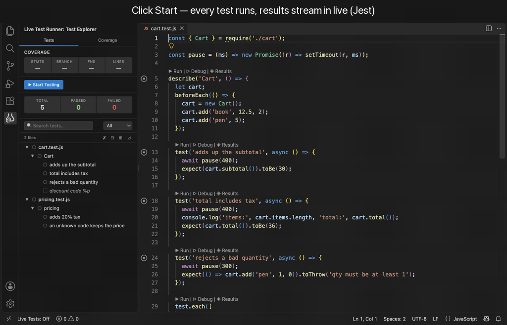
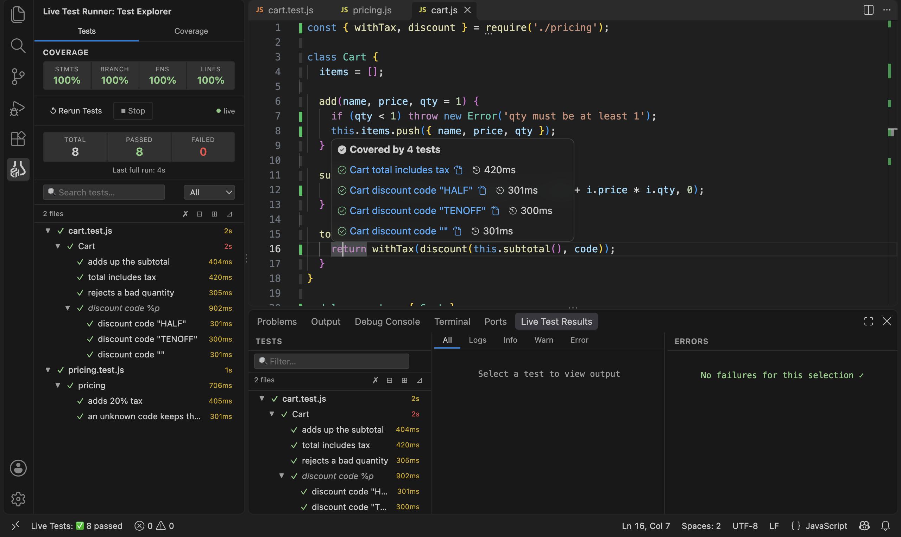

<!-- # Live Test Runner  -->

  <b>
    Live Test Runner
    
  </b>

> Save a file. Tests run. Results appear inline. No terminal. No config.

> **Works with Jest (incl. Create React App), Vitest and pytest** — zero config.

🌐 **[Website](https://eshandias.github.io/live-test-runner/)** · 📖 **[Read the full guide](https://eshandias.github.io/live-test-runner/guide/)** — or run **Live Test Runner: Open Guide** in VS Code.

---

## Quick Start

1. Open a Jest, Vitest or pytest project in VS Code
2. Click the **beaker icon** in the Activity Bar
3. Click **▶ Start Testing**
4. Save any file — only the tests it affects rerun

> No config, no extra installs. The framework (and, for pytest, the virtual environment) is detected from your project.

---

## What you get

- ⚡ **Reruns on save** — only the tests that ran the code you changed.
- 🌳 **Test tree** — every file, suite and test on open. Score cards (Total · Passed · Failed, plus **Running** while tests run) filter it with one click.
- 🎨 **In the editor** — ✓ / ✗ gutter icons, inline durations, `▶ Run` · `▷ Debug` · `◈ Results` above every test.
- 📊 **Coverage** — green / amber / red bars per line; hover a line to see which tests ran it.
- 🔍 **Results panel** — test list · console output (per test) · failures with the diff and location.
- 🗂 **Monorepos** — every package is a project; switch between them, run several at once.
- ⏱ **Timeline Debugger** *(coming soon)* — step through a finished test line by line.

---

## Jest, Vitest and pytest

- **Jest** (incl. Create React App) and **Vitest** — any UI framework: React, Vue, Svelte, Astro, Angular… if Jest or Vitest runs it, it works.
- **Both in one project** (migrating?) — each test file runs with its own framework; the tree groups them. Override with `liveTestRunner.frameworks`.
- **pytest** (≥ 7, Python ≥ 3.12) — runs in your project's own `.venv` / poetry / pipenv env — the Explorer shows which one (`🐍 Python 3.12 · .venv · pytest 9.1`); click it to pick another. Same results as `pytest` in your terminal, per-test output, ▶ Run / ▷ Debug, coverage via `coverage` (no pytest-cov needed).
- **Nothing is written into your project** — no installs, no config changes, no cache or coverage files.

---

## Commands

| Command | What it does |
|---------|-------------|
| `Start Testing` | Run all tests and start watching |
| `Stop Testing` | End the session |
| `Stop Testing and Clear Cache` | Stop + wipe discovery cache |
| `Clear Cache and Restart Testing` | Fresh restart |
| `Select Project` | Switch the project shown (same as the Explorer's switcher) |
| `Select Project Root` | Pin Live Test Runner to one folder (or back to all projects) |
| `Select Python Interpreter` | pytest projects: choose the Python environment that runs the tests (remembered per project) |
| `Stop All Projects` | Stop every running project |
| `Show Logs` | Open the extension log (filter by level) |
| `Show Test Output` | Open the raw test-runner output |
| `Copy Diagnostic Report` | Copy versions, setup and recent logs for a bug report |
| `Open Guide` | Open the user guide in an editor tab |

> **Tip:** Shift-click **⏹ Stop** to stop and clear cache in one click.

---

## Troubleshooting

- **Output → "Live Test Runner"** — what the extension did: one line per run, warnings when something falls back. Set the level to **Debug** (⚙ in the Output panel) for details.
- **Output → "Live Test Runner: Test Output"** — exactly what Jest / Vitest / pytest printed.
- Reporting a bug? Run **Copy Diagnostic Report** and attach it.

---

## Configuration

All settings under `liveTestRunner.*`.

| Setting | Default | Description |
|---------|---------|-------------|
| `projectRoot` | `""` | Pin to one project root; empty = detect every project in the workspace |
| `maxRunningProjects` | `"auto"` | Projects running at once: `auto` = 2 (1 on ≤ 4 cores or < 8 GB total memory), or a number |
| `runMode` | `"auto"` | `"auto"` calls Jest directly; `"npm"` delegates to `npm test` (Jest only) |
| `jestCommand` | `""` | Override Jest binary path |
| `vitestCommand` | `""` | Override the Vitest command (e.g. `npx vitest`); empty = the project's own Vitest |
| `frameworks` | `{}` | Jest + Vitest projects: glob → `"jest"` / `"vitest"` for those test files |
| `vitestTrace` | `true` | Vitest execution trace: covering tests on hover, and saves rerun only the tests that ran the file |
| `vitestIncludeBrowserProjects` | `false` | Also run Vitest browser-mode projects (need Playwright / WebdriverIO browsers) |
| `pythonPath` | `""` | pytest: the Python that runs the tests; empty = automatic (selected interpreter, the project's venv, the Python extension's, PATH) |
| `pytestArgs` | `[]` | pytest: extra arguments for every run, e.g. `["-m", "not slow"]` (your `addopts` already apply) |
| `onSaveDebounceMs` | `300` | Debounce delay after save (ms) |
| `hangTimeoutSeconds` | `300` | Stop a single test running longer than this (e.g. an infinite loop) and mark it failed; `0` = no limit |
| `testFilePatterns` | `["**/*.test.*", "**/*.spec.*", "**/__tests__/**/*.*"]` | Which files appear in the test tree. Jest's own config still decides what runs, and files it runs are added even when no pattern matches |
| `coverageExclude` | `[]` | Extra globs left out of the coverage totals (which otherwise follow your Vitest `coverage.include` / `exclude` or Jest `collectCoverageFrom`) |
| `durationThresholds.testAmberMs` | `100` | Test turns amber |
| `durationThresholds.testRedMs` | `500` | Test turns red |
| `durationThresholds.suiteAmberMs` | `500` | Suite turns amber |
| `durationThresholds.suiteRedMs` | `2000` | Suite turns red |
| `durationThresholds.fileAmberMs` | `1000` | File turns amber |
| `durationThresholds.fileRedMs` | `5000` | File turns red |

---

## Supported frameworks

<!-- matrix:start -->
| Feature | Jest | CRA | Vitest | pytest |
|---|---|---|---|---|
| Run & pass/fail | ✅ | ✅ | ✅ | ✅ pytest ≥ 7, Python ≥ 3.12 |
| ▶ Run / ▷ Debug one test or suite | ✅ | ✅ | ✅ | ✅ by node id; Debug needs the Python Debugger extension |
| Rerun a saved test file | ✅ | ✅ | ✅ | ✅ |
| Logs / console output | ✅ per file | ✅ per file | ✅ per test | ✅ per test (stdout, stderr, logging) |
| Coverage (gutter, hover) | ✅ | ✅ | ✅ needs `@vitest/coverage-v8` (or `-istanbul`) | ✅ needs `coverage` (pytest-cov not needed) |
| Live per-file progress | ✅ | ✅ | ✅ | ✅ |
| Rerun tests related to a saved source file | ✅ | ✅ | ✅ only the tests that ran it (execution trace); `vitest related` when the trace is off | ✅ only the tests that ran it (coverage contexts); importing test files before that |
| Monorepo / multi-project (project switcher) | ✅ one project per package; a root `projects` config stays one | 🟡 a CRA app is detected as a package (not e2e-tested) | ✅ one project per package; `test.projects` stays one, grouped by name | ⏳ later (one pytest project per folder today) |
| Mixed Jest + Vitest in one project | ✅ each test file runs with its own framework | — | ✅ | — |
| Execution trace / "covering tests" | ✅ | ✅ | ✅ Vitest ≥ 3 (incl. `vitest.workspace` files); not in browser mode | ✅ from coverage.py contexts (needs `coverage`) |
| UI components (`.vue`, `.svelte`, `.astro`, `.marko`): save reruns, trace, coverage | ✅ through the project's transformer (vue-jest, svelte-jester…) | — (React is plain JS) | ✅ through the project's Vite plugins | — |
| Timeline debugger | ⏳ | ⏳ | ⏳ later | ⏳ later |
<!-- matrix:end -->

Vitest 3+ is fully supported (1–2: results only). Jest's ESM mode is picked up from your test script or `.npmrc`. Full details: [the guide](https://eshandias.github.io/live-test-runner/guide/).

---

## Known limitations

- Individual test reruns use `--testNamePattern` — tests with exactly the same full name run together
- Jest captures console output per file; it shows on a single test only when that test is rerun on its own. With Vitest every test shows its own output.
- Test-level granularity and per-test console logs are only available after the background trace pass completes for a file; whole-file reruns are used as fallback
- Vitest: the execution trace needs Vitest ≥ 3 and is off for browser-mode projects — saving a source file then reruns the test files that import it (`vitest related`)
- pytest: one project per folder — Python monorepos and a JS + Python project in one folder are planned; the Timeline debugger is not available for pytest yet
- pytest with `-s` / `--capture=no` in `addopts`: test output goes to the Test Output channel, not to each test
- Vue components under Jest: coverage counts the `<script>` block only, as `jest --coverage` does (vue-jest maps only that); template lines still show their covering tests

---

## About

  

Built by **EshLabs** (Eshan Dias) — a software engineer who wanted live test feedback without paying for third-party tools.

⭐ [Star on GitHub](https://github.com/eshandias/live-test-runner) · 🐛 [Report an issue](https://github.com/eshandias/live-test-runner/issues)

---

MIT License
